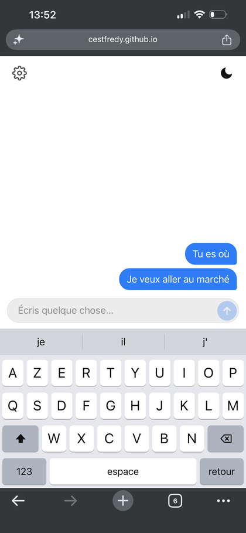
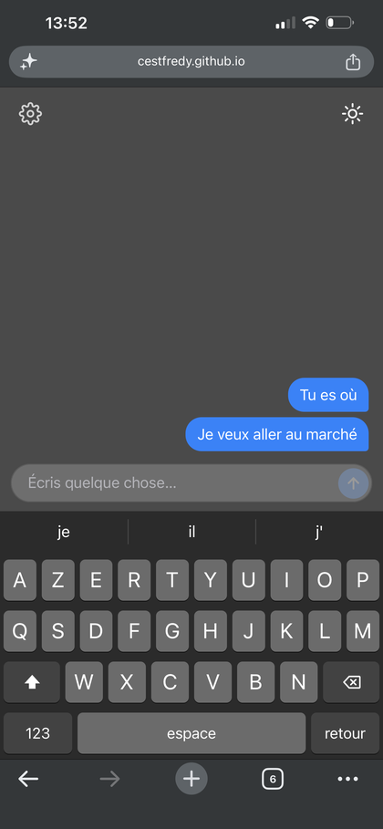
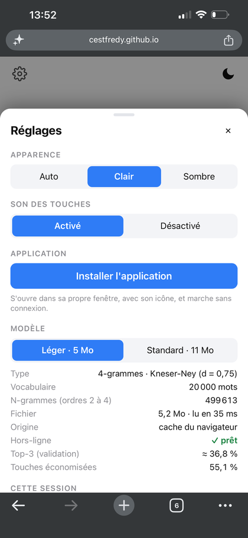
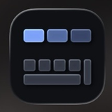

# ngram-keyboard

Un clavier prédictif français qui marche **sans connexion** : un modèle n-gramme (Kneser-Ney) suggère les 3 mots suivants, mesuré proprement, avec une démo en HTML, CSS et JavaScript purs.

**[Essayer la démo](https://cestfredy.github.io/ngram-keyboard/)** (sur téléphone : Partager --> Sur l'écran d'accueil pour l'installer)

*English summary: a French next-word predictor (4-gram, interpolated Kneser-Ney, 5 to 11 MB) that runs 100 % offline in the browser. On the held-out test split, the right word is in the 3 suggestions 39.05 % of the time with no letter typed, and a typing simulation saves 56.41 % of keystrokes. Details below, in French.*

<p align="center">
  
  
  
</p>
<p align="center"><em>mode clair, mode sombre et réglages.</em></p>

## Ce que ça fait

À partir des mots déjà tapés, le modèle propose les 3 mots les plus probables, et les affine à mesure qu'on tape des lettres. Le modèle, l'application et le service worker sont gardés par le navigateur après la première visite : pas de serveur, pas de suivi, pas besoin de réseau.

- **Modèle :** 4-grammes, lissage Kneser-Ney interpolé (d = 0,75), vocabulaire de 20 000 mots, élagage des n-grammes rares.
- **Taille :** 5,2 Mo (léger) ou 11,3 Mo (standard), dans un format binaire compact lu directement par JavaScript.
- **Vitesse :** environ 0,5 ms par frappe (suggestions et affichage) dans Chrome.
- **Installable :** ajoutée à l'écran d'accueil, elle s'ouvre comme une vraie application, avec son icône .

## Résultats

Mesurés **une seule fois** sur le jeu de test (35 814 phrases, 275 535 mots), à la fin, sur des modèles figés après la validation (`ngram/src/evaluate_test.py`, `ngram/results/test_final.csv`).

| Modèle | Perplexité | Top-1 | Top-3 | Touches économisées |
|--------|-----------:|------:|------:|--------------------:|
| Référence : mots les plus fréquents | n/a | 3,08 % | 7,55 % | 38,45 % |
| 4-grammes, sans élagage | 41,5 | 25,75 % | 41,11 % | |
| 4-grammes, standard (livré, 11,3 Mo) | 62,1 | 24,28 % | 39,05 % | 56,41 % |
| 4-grammes, léger (livré, 5,2 Mo) | 83,4 | 22,77 % | 36,99 % | 55,36 % |

- **Top-1 / top-3 :** le bon mot est-il parmi les 1 ou 3 suggestions, avant d'avoir tapé la moindre lettre ? Un mot hors du vocabulaire compte comme raté.
- **Touches économisées :** simulation d'un utilisateur qui tape lettre par lettre et touche une suggestion dès qu'elle est bonne (1 touche pour le mot et l'espace). La référence économise déjà 38 % grâce aux premières lettres ; le contexte apporte les 18 points restants.
- **Le contexte compte :** sur la validation, la perplexité passe de 488 (sans contexte) à 81, 48 puis 42 avec 1, 2 et 3 mots de contexte (bigramme, trigramme, 4-grammes).
- **L'élagage coûte peu :** le modèle léger perd 4 points de top-3 mais un seul point d'économie de touches.

Les choix, la validation et chaque chiffre avec sa justification sont dans [`ngram/JOURNAL.md`](ngram/JOURNAL.md).

## Comment ça marche

1. **Données :** 730 079 phrases françaises de Tatoeba, nettoyées, dédupliquées, puis découpées 90/5/5 avec une graine fixe.
2. **Modèle :** comptages de n-grammes sur l'entraînement seul, vocabulaire des 20 000 mots les plus fréquents, lissage Kneser-Ney.
3. **Top-3 exact :** le calcul passe par les candidats des contextes longs plus un classement des mots fréquents, sans noter tout le vocabulaire.
4. **Export :** les n-grammes rares sont élagués et le reste est écrit dans un format binaire (`.ngm`) lu par `keyboard/js/model.js`.
5. **Parité :** le lecteur JavaScript donne les mêmes suggestions que le modèle Python (0 écart sur 3 000 cas réels par modèle).

## Limites

- **Phrases écrites et traduites, pas de messages réels :** Tatoeba contient peu d'argot et le prénom « Tom » apparaît dans 6 % des phrases, donc il ressort dans les suggestions. Un second corpus (sous-titres) est la suite prévue.
- **Économie idéale :** la simulation suppose qu'on touche toujours la bonne suggestion ; en vrai, c'est moins (27 % sur une courte conversation de test).
- **Vocabulaire fermé :** les mots hors des 20 000 plus fréquents ne sont jamais proposés (2,9 % des mots).
- **Pas de personnalisation :** le modèle ne s'adapte pas à ce que l'utilisateur écrit.

## Lancer le projet

```bash
# Données : télécharger fra_sentences.tsv.bz2 sur https://tatoeba.org/en/downloads et le placer dans ngram/data/raw/

cd ngram
pip install -r requirements.txt
python src/prepare_data.py        # nettoyage, déduplication, découpage
python src/evaluate_ngrams.py     # perplexité et top-k sur la validation
python src/make_web_model.py      # écrit keyboard/models/*.ngm
python -m pytest                  # 104 tests

cd ../keyboard
python -m http.server 8000        # puis http://localhost:8000
python tests/e2e.py               # vrai Chromium : saisie, hors-ligne, installation
```

Le détail de la démo est dans [`keyboard/README.md`](keyboard/README.md). Le dépôt est organisé en deux dossiers : `ngram/` (le modèle, les évaluations, le journal) et `keyboard/` (l'application web).

## Données et licences

- **Code :** MIT (voir `LICENSE`).
- **Tatoeba :** phrases françaises de [Tatoeba](https://tatoeba.org), sous licence CC-BY 2.0 FR ; l'attribution est obligatoire. Les deux modèles de `keyboard/models/` contiennent des statistiques de n-grammes dérivées de ces phrases, sous la même obligation d'attribution.
