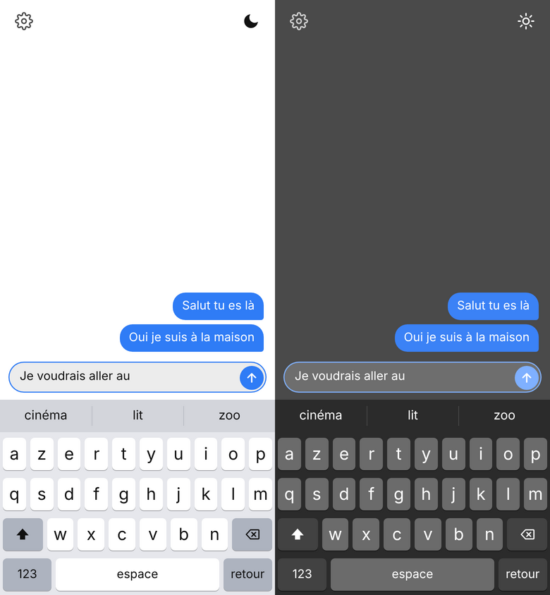
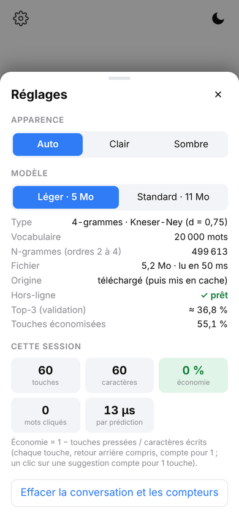

# ngram-keyboard

A small French next-word predictor: an interpolated Kneser-Ney n-gram model, evaluated offline, running **100 % offline in the browser** inside a keyboard simulator written in plain HTML, CSS and JavaScript.

**[Try the demo](https://cestfredy.github.io/ngram-keyboard/)** (open it on a phone and use "Add to Home Screen" to install it)

*(FR : un modèle n-gramme (Kneser-Ney) qui suggère les 3 mots suivants en français, mesuré proprement, et une démo de clavier qui marche sans connexion.)*

<p align="center"></p>

## What it does

Given the words already typed, the model suggests the 3 most likely next words, and narrows them down as letters are typed. Everything (model, app, service worker) is cached by the browser after the first visit: no server, no tracking, no network needed.

- **Model:** 4-gram, interpolated Kneser-Ney (discount 0.75), 20,000-word vocabulary, count-threshold pruning.
- **Size:** 5.2 MB (light) or 11.3 MB (standard) in a compact binary format read directly by JavaScript.
- **Speed:** about 0.5 ms per keystroke (suggestions plus rendering) in Chromium; each prediction needs less than 1 ms in the Python reader.
- **Quality:** on the held-out test split, the right word is among the 3 suggestions 37.0 % to 39.1 % of the time before any letter is typed, and 55 % to 56 % of keystrokes are saved in a typing simulation (details below).

The settings panel shows the loaded model (size, n-gram count, load time, offline status), its validated figures, and live counters for the current session (keys pressed, characters written, saving, time per prediction):

<p align="center"></p>

## Results

### Final results: test split

The test split (35,814 sentences, 275,535 word positions) was evaluated **once**, at the very end, on models frozen after validation: nothing was tuned on it, and the script locks itself after running (`ngram/src/evaluate_test.py`, `ngram/results/test_final.csv`).

| Model | Perplexity | Top-1 | Top-3 | Keystroke savings |
|-------|-----------:|------:|------:|------------------:|
| Unigram baseline (most frequent words, ignores context) | n/a | 3.08 % | 7.55 % | 38.45 % |
| 4-gram, no pruning | 41.5 | 25.75 % | 41.11 % | |
| 4-gram, standard (shipped, 11.3 MB) | 62.1 | 24.28 % | 39.05 % | 56.41 % |
| 4-gram, light (shipped, 5.2 MB) | 83.4 | 22.77 % | 36.99 % | 55.36 % |

Accuracy and keystroke savings on test are 0.2 to 0.4 point above validation and perplexity is 1 to 2 % lower, about the size of the sampling noise, so the validation choices did not overfit. Top-1 and top-3 use every test position (no sampling). The perplexity of the unigram baseline was not measured on the test split (487.8 on validation), to keep the test split to one evaluation of the final models.

### Development results: validation split

All numbers below are measured on the **validation split** (35,813 sentences, 276,255 word positions), which was used to choose the model.

| Model | Perplexity | Top-1 | Top-3 | Keystroke savings |
|-------|-----------:|------:|------:|------------------:|
| Unigram baseline (most frequent words, ignores context) | 487.8 | 3.11 % | 7.55 % | 38.32 % |
| Bigram (n=2) | 81.0 | 14.85 % | 28.45 % | |
| Trigram (n=3) | 48.1 | 22.24 % | 37.78 % | |
| 4-gram, no pruning (n=4) | 42.2 | 25.52 % | 40.80 % | |
| 4-gram, standard (shipped, 11.3 MB) | 63.0 | 23.98 % | 38.79 % | 56.18 % |
| 4-gram, light (shipped, 5.2 MB) | 85.0 | 22.41 % | 36.80 % | 55.12 % |

- **Top-1 / top-3** is next-word accuracy with no letter typed yet; a target outside the 20,000-word vocabulary counts as a miss. For the bigram and trigram rows, and for the pruned models, top-k is measured on a fixed random sample of 5,000 validation sentences (seed 42); the unpruned 4-gram row uses the full validation split. Perplexity always uses the full split.
- **Keystroke savings** simulate a user who types letter by letter, with 3 suggestions refreshed after every letter. Tapping a suggestion costs 1 key and inserts the word and a space. The baseline is one key per character, including the space. Words outside the vocabulary are typed in full. The unigram baseline suggests the most frequent words (with no letter typed it always shows `de je est`) and already saves 38 %, because a word is often found after one or two letters; this shows how much of the gain comes from the typed prefix rather than from the language model.
- Pruning trades quality for size: removing rare n-grams raises the perplexity of the light model from 42 to 85 and costs 4 points of top-3, but only 1.1 point of keystroke savings, because once a letter or two is typed the candidate set is small and context matters less.
- The simulation is an upper bound: it assumes the user always taps the right suggestion as soon as it appears. In a real session on a phone, with free text, the saving was lower (27 % on a short test conversation). The settings panel of the demo shows both the validated figures and the live figures of the current session.

The full list of decisions, with the number that justified each one, is in [`ngram/JOURNAL.md`](ngram/JOURNAL.md); raw result tables are in [`ngram/results/`](ngram/results).

## How it works

1. **Data:** 730,079 French sentences from Tatoeba, cleaned (apostrophes, spaces, case, non-Latin text), deduplicated on token sequences, then split 90/5/5 with a fixed seed. Elisions are split (`l'` + `ami`) and hyphenated words are kept whole (`est-ce`). Details and the measured effect of each rule are in the journal.
2. **Model:** counts of 1- to 4-grams from the training split only, interpolated Kneser-Ney smoothing with a fixed discount. The vocabulary is the 20,000 most frequent training words plus `<s>`, `</s>` and `<unk>`.
3. **Exact top-3:** the best words are found from the candidate sets of the longer contexts plus a unigram ranking, not by scoring the whole vocabulary. Suggestions restricted to a typed prefix use the fact that token ids are alphabetical, so all words with a given prefix form one contiguous range.
4. **Compact export:** counts below a threshold are pruned (`2,3,4` for orders 2, 3, 4 for the light model), and the rest is stored in a flat binary format (`.ngm`: a JSON header plus sorted integer arrays). The JavaScript reader does a binary search over sorted rows.
5. **Parity:** the JavaScript reader returns the same suggestions as the Python model on 3,000 real contexts per model (0 differences), and is tested against a tiny versioned model.

## Repository layout

| Path | Content |
|------|---------|
| `ngram/` | Python package (`src/ngramlm`), training and evaluation scripts, results, 104 tests, `JOURNAL.md` |
| `keyboard/` | The web app: `index.html`, `css/`, `js/`, service worker, manifest, icons, the two models, tests |
| `docs/img/` | Screenshots used in this README |

## Run it yourself

```bash
# 1. Data and models
#    First download the French sentences (fra_sentences.tsv.bz2) from https://tatoeba.org/en/downloads
#    and put the file in ngram/data/raw/
cd ngram
pip install -r requirements.txt
python src/prepare_data.py            # clean, deduplicate, split
python src/evaluate_ngrams.py         # perplexity and top-k on the validation split
python src/evaluate_pruning.py        # size / quality trade-off
python src/evaluate_keystrokes.py     # keystroke-savings simulation
python src/make_web_model.py          # writes keyboard/models/*.ngm
python -m pytest                      # 104 tests

# 2. The web demo
cd ../keyboard
python -m http.server 8000            # then open http://localhost:8000
node --test tests/model.test.mjs      # JavaScript reader vs Python model
python tests/e2e.py                   # real Chromium: typing, offline, install, themes
```

See [`keyboard/README.md`](keyboard/README.md) for the web app details.

## Limitations

- **Written, translated sentences, not chat text.** Tatoeba has almost no slang, abbreviations or emojis, and the name "Tom" appears in 6 % of its sentences, so it shows up in suggestions. A second corpus (conversational subtitles) is the next planned step.
- **No personalisation.** The model is fixed; it does not learn from what the user types.
- **Closed vocabulary.** Words outside the 20,000 most frequent are never suggested (2.9 % of validation tokens).
- **Simulated savings.** The keystroke figures assume an ideal user; real-world savings are lower, as the live counter in the demo shows.

## Data and licenses

- **Code:** MIT (see `LICENSE`).
- **Tatoeba:** French sentences from [Tatoeba](https://tatoeba.org), licensed CC-BY 2.0 FR. Attribution is required. The two model files in `keyboard/models/` contain n-gram statistics derived from these sentences and are distributed under the same attribution requirement.
- **Raw and processed corpora are not redistributed** and are excluded from the repository (`.gitignore`).
